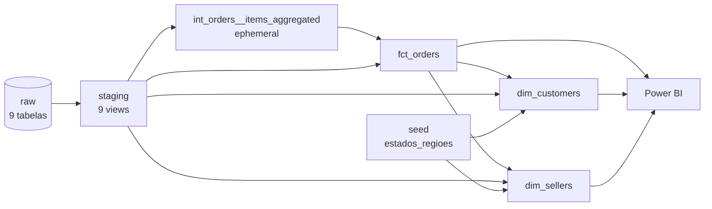

# dbt-olist

Projeto de estudo de dbt Core com dados públicos de e-commerce da Olist.

## Pré-requisitos

- Python 3.12 (veja `.python-version`)
- PostgreSQL 17 com o banco `olist` e o usuário `dbt_user` como dono do banco
- VS Code com a extensão dbt Power User

## Configuração


```powershell
python -m venv .venv
.venv\Scripts\Activate
python -m pip install -r requirements.txt
```

1. Copie o modelo de variáveis:

   ```powershell
   Copy-Item olist\.env.example olist\.env
   ```

2. Abra `olist/.env` e preencha `DBT_ENV_SECRET_PG_PASSWORD` com a senha do `dbt_user`

3. Abra a pasta `dbt-olist` no VS Code e selecione o interpretador `.venv`

## Dados

1. Baixe o dataset "Brazilian E-Commerce Public Dataset by Olist" no Kaggle
2. Extraia os 9 CSVs em `data/raw/` (a pasta é ignorada pelo Git)
3. Carregue no schema `raw` do Postgres:

```powershell
python ingestion\load_olist.py
```

O script é idempotente: rodar de novo recarrega as tabelas sem duplicar linhas.


## Como rodar

Os comandos do dbt rodam de dentro da pasta `olist`, que é de onde o `.env` e o `profiles.yml` são lidos:

```powershell
cd olist
dbt debug
```

## Arquitetura



| Camada | Materialização | Regra |
| --- | --- | --- |
| staging | view | 1 para 1 com a fonte: só renomeia, converte tipos e padroniza |
| intermediate | ephemeral | Agrega antes do join, para não multiplicar linhas |
| marts | table | O que o Power BI consome; grão documentado em cada modelo |

## Modelos

| Modelo | Grão | Linhas |
| --- | --- | --- |
| `fct_orders` | Um pedido | 99.441 |
| `dim_customers` | Um cliente real (`customer_unique_id`) | 96.096 |
| `dim_sellers` | Um vendedor | 3.095 |

## Decisões de modelagem

- **Receita oficial = itens + frete, zero para cancelados.** O `paid_amount` fica no fato só
  para conciliação, porque inclui juros de parcelamento e vouchers.
- **Cancelados não são filtrados.** Ficam no fato com `is_canceled = true`, para que o mesmo
  modelo responda "quanto vendemos" e "quanto foi cancelado".
- **Itens e pagamentos são agregados antes do join.** Um pedido tem até 21 itens e 29 pagamentos;
  o join direto multiplicaria a receita.
- **O cliente é o `customer_unique_id`.** O `customer_id` muda a cada pedido; usá-lo
  esconderia a recompra (2.888 clientes).
- **`seller_id` não está no `fct_orders`.** 1.278 pedidos têm mais de um vendedor; a análise
  por vendedor usa o grão de item.
- **A chave das reviews é `review_id` + `order_id`.** 789 `review_id` aparecem em mais de um pedido.

## Testes

49 testes em todas as camadas. Os mais importantes:

| Teste | O que protege |
| --- | --- |
| `assert_receita_reconcilia_marts` | A receita é a mesma no fato e nas duas dimensões |
| `unique` + `not_null` nas chaves | Nenhuma chave duplicada inflando a receita |
| `relationships` em `fct_orders` | Todo pedido aponta para um cliente existente |
| `assert_parcelas_validas` (warn) | Parcelas entre 1 e 24; a fonte tem 2 casos com 0, conhecidos |

## Como rodar o pipeline

```powershell
cd olist
dbt source freshness   # os dados chegaram nas últimas 48 h?
dbt build              # modelos e testes, na ordem do DAG
dbt docs generate
dbt docs serve         # documentação e lineage em http://localhost:8080
```
